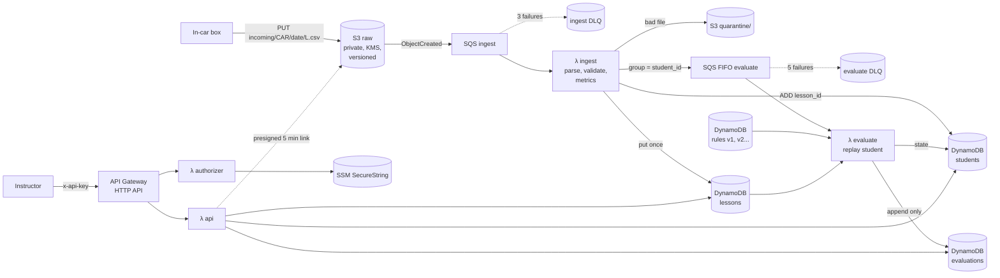

# DriveCoach backend

Amit Levy


Serverless AWS backend that turns lesson files uploaded by in-car sensor boxes into
PASS / REVIEW / FAIL / INVALID decisions, keeps each student's progress, and
records an audit trail that can explain every decision later.

Python 3.12 on Lambda, DynamoDB, SQS, S3, API Gateway, Terraform, GitHub Actions.

- [Architecture](#architecture)
- [Deploy and destroy](#deploy-and-destroy)
- [Results on the provided data](#results-on-the-provided-data)
- [What I found in the starter kit](#what-i-found-in-the-starter-kit)
- [Assumptions](#assumptions)
- [Level 2: failure handling, ordering, observability, API, cost](#level-2)
- [Level 3: rules v2, instructor feature, late files and 100x scale](#level-3)
- [Testing](#testing)
- [With another week](#with-another-week)

---

## Architecture



### How a file becomes a decision

1. **Upload.** A box writes `incoming/<car>/<date>/<lesson>.csv`. S3 sends an event to the
   **ingest queue** (SQS). A queue sits between S3 and Lambda, so bursts are buffered and
   failures are retried and end up in a **dead letter queue** (DLQ).
2. **Ingest** (`src/drivecoach/handlers/ingest.py`) parses and validates the file
   (`lesson_file.py`), converts speed to km/h, computes the metrics (`metrics.py`), and
   stores the lesson **once**, keyed by `lesson_id`, with a content fingerprint.
   - Broken file → copied to `quarantine/` with the reason, alarm. No retries, because they would never succeed.
   - Same `lesson_id`, same recording (a box retry) → recorded as a duplicate upload, nothing else changes.
   - Same `lesson_id`, *different* recording → quarantined as a conflict. We never silently pick one.
3. Ingest adds the lesson to the student's lesson index and sends a message to the
   **evaluate FIFO queue** with `MessageGroupId = student_id`. FIFO means one worker per
   student at a time (no lost updates), while different students run in parallel.
4. **Evaluate** (`handlers/evaluate.py`) **rebuilds the student's state from scratch**:
   the initial state from `students.csv`, plus all of the student's lessons sorted by
   `started_at`, each evaluated with the rules in force on that lesson's start date
   (`rules.py`, `progress.py`). A lesson whose outcome is new or different gets a new
   **append-only audit record**. If a late file changes an earlier decision, the new
   record points to the one it `supersedes`, so history is never rewritten.
5. **Read API.** `GET /students/{id}` and `GET /lessons/{id}` behind a Lambda authorizer.

**Why rebuild instead of updating state incrementally?** Upload order, retries and late files
stop mattering: the state is a pure function of (initial state, lessons, rules). The
replay is a few milliseconds of in-memory work per student. See [Level 3](#level-3) for
when this stops being cheap.

### Data model (DynamoDB, on-demand, KMS encrypted, point-in-time recovery)

| Table | Key | Content |
|---|---|---|
| `lessons` | `lesson_id` | Header (no PII), metrics, event timeline, S3 location, fingerprint, duplicate uploads |
| `evaluations` | `lesson_id` + `evaluated_at` | **Audit**: rules version + sha256, input metrics, rule result, final result (after escalation), reasons, state before/after, state change, trigger, supersedes |
| `students` | `student_id` + `record` | `INITIAL` (enrolment snapshot), `STATE` (computed, optimistic lock), `LESSONS` (lesson index) |
| `rules` | `version` | The exact JSON document of each published rule set |

### Code map

```
src/drivecoach/
  lesson_file.py   parse + validate, unit conversion, content fingerprint
  metrics.py       section 5 metrics, event detection, event timeline
  rules.py         validation, selection by effective date, evaluation, rules hash
  progress.py      section 7 state machine + replay fold (pure, no AWS)
  store.py         DynamoDB access
  log.py           JSON logs + CloudWatch EMF metrics
  handlers/        ingest, evaluate, api, authorizer (thin AWS adapters)
terraform/         main stack (kms, storage, queues, dynamodb, lambda, api, observability)
terraform/bootstrap/  one-time: budget alert, state bucket, GitHub OIDC deploy role
rules/             versioned rule sets + published.json (immutability lock)
scripts/           upload_lessons.sh (given), upload_burst.sh, report.py
tests/             unit, golden results, moto integration tests
```

The business logic (`lesson_file`, `metrics`, `rules`, `progress`) has no AWS imports and
is fully testable offline. The handlers are thin.

---

## Deploy and destroy

Prerequisites: AWS CLI v2 logged in with an admin profile, Terraform ≥ 1.10, Python 3.12, make.

```bash
# once: $10 budget alert, Terraform state bucket, GitHub OIDC role
make bootstrap GITHUB_REPO=<owner>/<repo> EMAIL=<you@example.com>

make deploy                 # one command: package + terraform apply (incl. rules v1 and students)
make upload                 # scripts/upload_lessons.sh against the deployed bucket
make results                # prints the results tables below, from the live API
make destroy                # one command: tear everything down
```

Other targets: `make test`, `make upload-burst` (all files at once, shuffled),
`make api-key`, `make replay-dlq QUEUE=ingest|evaluate`, `make reset` (demo only: forget all
processed lessons, keep rules and initial students, so the files can be uploaded again).

### Calling the API

```bash
API=$(terraform -chdir=terraform output -raw api_url)
KEY=$(make -s api-key)
curl -s -H "x-api-key: $KEY" $API/students/S-002 | jq
curl -s -H "x-api-key: $KEY" $API/lessons/L-1015 | jq
```

### CI/CD (`.github/workflows/ci.yml`)

- Every push and PR: pytest (unit + golden + moto integration), `terraform fmt -check`, `validate`.
- Push to `main`: assume the deploy role through **GitHub OIDC** (no AWS keys stored in GitHub),
  `terraform plan` + `apply`, then a smoke test that the API returns 200 with the key and
  rejects calls without it.
- Repository variables: `AWS_REGION`, `TF_STATE_BUCKET`, `AWS_DEPLOY_ROLE_ARN` (printed by `make bootstrap`).

---

## Results on the provided data

Produced on the live deployment (us-east-1, 2026-10-17) by `scripts/upload_lessons.sh` in
field order, then `make results`, which reads everything back through the authenticated API.

**Ordering, verified live:** after `make reset`, `make upload-burst` (all 16 files in parallel,
random order) gave **identical** results and final states. Lessons that arrived before an
earlier lesson of the same student were re-judged when it arrived: 12 re-evaluations, each
audit record linking to the one it `supersedes`. The test suite also checks 5 random orders.

<!-- RESULTS:START -->
### Lessons (in field upload order)

| File | Lesson | Student | Type | Duration (min) | Distance (km) | Avg moving km/h | Over limit % | Brakes | Accels | Turns | Max lat g | Score | Result | Why |
|---|---|---|---|---|---|---|---|---|---|---|---|---|---|---|
| L-1001.csv | L-1001 | S-001 | REGULAR | 20.00 | 15.68 | 48.0 | 0.78 | 1 | 1 | 0 | 0.310 | 90.44 | **PASS** |  |
| L-1004.csv | L-1004 | S-002 | REGULAR | 20.00 | 16.19 | 50.4 | 0.63 | 0 | 1 | 1 | 0.478 | 91.74 | **PASS** |  |
| L-1009.csv | L-1009 | S-003 | REGULAR | 20.00 | 19.87 | 60.0 | 9.69 | 1 | 1 | 1 | 0.528 | 68.61 | **REVIEW** | pct_time_over_limit > 5 (file is in **mph**) |
| L-1012.csv | L-1012 | S-004 | REGULAR | 20.00 | 15.33 | 46.7 | 1.85 | 3 | 4 | 1 | 0.505 | 65.29 | **REVIEW** | harsh_brake_count >= 3; harsh_accel_count >= 4 |
| L-1002.csv | L-1002 | S-001 | REGULAR | 20.00 | 17.03 | 52.6 | 0.91 | 0 | 2 | 1 | 0.542 | 88.19 | **PASS** |  |
| L-1005.csv | L-1005 | S-002 | REGULAR | 20.00 | 12.67 | 39.3 | 0.50 | 4 | 1 | 1 | 0.496 | 72.00 | **REVIEW** | harsh_brake_count >= 3 |
| L-1010.csv | L-1010 | S-003 | PRACTICE | 20.00 | 14.77 | 45.0 | 22.55 | 2 | 2 | 1 | 0.538 | 34.91 | **FAIL** | pct_time_over_limit > 15 (mph) |
| L-1013.csv | L-1013 | S-004 | PRACTICE | 20.00 | 16.40 | 50.0 | 0.62 | 1 | 1 | 1 | 0.495 | 86.77 | **PASS** |  |
| L-1006.csv | L-1006 | S-002 | PRACTICE | 20.00 | 17.40 | 52.8 | 0.29 | 1 | 1 | 0 | 0.323 | 91.42 | **PASS** |  |
| L-1003.csv | L-1003 | S-001 | REGULAR | 20.00 | 14.87 | 46.2 | 0.22 | 1 | 0 | 1 | 0.511 | 90.57 | **PASS** |  |
| L-1007.csv | L-1007 | S-002 | REGULAR | 20.00 | 14.63 | 45.6 | 8.14 | 1 | 2 | 3 | 0.522 | 60.72 | **REVIEW** | pct_time_over_limit > 5; sharp_turn_count >= 3 |
| L-1007_retry1.csv | L-1007 | S-002 | | | | | | | | | | | duplicate upload, ignored | same recording as L-1007.csv |
| L-1014.csv | L-1014 | S-004 | REGULAR | 8.00 | 5.26 | 39.8 | 19.62 | 6 | 3 | 2 | 0.503 | 13.77 | **INVALID** | duration_min < 15 |
| L-1008.csv | L-1008 | S-002 | PRACTICE | 20.00 | 13.03 | 39.5 | 0.58 | 0 | 1 | 1 | 0.537 | 91.83 | **PASS** |  |
| L-1011.csv | L-1011 | S-003 | REGULAR | 20.00 | 16.27 | 49.3 | 0.74 | 1 | 1 | 0 | 0.318 | 90.52 | **PASS** |  |
| L-1015.csv | L-1015 | S-004 | REGULAR | 20.00 | 14.25 | 43.8 | 1.04 | 6 | 2 | 3 | 0.720 | 49.91 | **FAIL** | harsh_brake_count >= 6; max_lateral_g > 0.65 |

### State changes, per student in `started_at` order

| Student | Lesson | Result | Change |
|---|---|---|---|
| S-001 | L-1001 | PASS | lessons 9 → 10 |
| S-001 | L-1002 | PASS | lessons 10 → 11 |
| S-001 | L-1003 | PASS | lessons 11 → 12, ACTIVE → **COMPLETED**, final_score 89.73 |
| S-002 | L-1004 | PASS | lessons 4 → 5 |
| S-002 | L-1005 | REVIEW | review_count 0 → 1, next PRACTICE |
| S-002 | L-1006 | PASS (practice) | next REGULAR |
| S-002 | L-1007 | REVIEW | review_count 1 → 2, next PRACTICE |
| S-002 | L-1008 | PASS (practice) | next REGULAR |
| S-003 | L-1009 | REVIEW | review_count 1 → 2, next PRACTICE |
| S-003 | L-1010 | FAIL | STANDARD → **EXTENDED**, review_count 2 → 0, next REGULAR |
| S-003 | L-1011 | PASS | lessons 6 → 7 |
| S-004 | L-1012 | REVIEW | review_count 1 → 2, next PRACTICE |
| S-004 | L-1013 | PASS (practice) | next REGULAR |
| S-004 | L-1014 | INVALID | none |
| S-004 | L-1015 | FAIL | ACTIVE → **INSTRUCTOR_REVIEW** (already EXTENDED) |

### Final student state

| Student | Program | Lessons completed | Review count | Next lesson | Status | Final score |
|---|---|---|---|---|---|---|
| S-001 | STANDARD | 12 | 0 | REGULAR | COMPLETED | 89.73 |
| S-002 | STANDARD | 5 | 2 | REGULAR | ACTIVE |  |
| S-003 | EXTENDED | 7 | 0 | REGULAR | ACTIVE |  |
| S-004 | EXTENDED | 10 | 2 | REGULAR | INSTRUCTOR_REVIEW |  |
<!-- RESULTS:END -->

S-001's final score is the mean of L-1001, L-1002 and L-1003, the REGULAR lessons that passed
*in this system* (as the spec says). The 9 lessons completed before go-live have no
scores here.

### Results that a naive implementation would get wrong

| Trap | Naive result | Correct |
|---|---|---|
| CAR-03 reports `speed_unit: mph` | L-1009 and L-1010 PASS (0.0% over the limit), S-003 ends STANDARD 8/12 | L-1009 REVIEW, L-1010 FAIL, S-003 EXTENDED 7/18 |
| `L-1007_retry1.csv` re-uploads L-1007 | S-002 review_count 3 > 2 → FAIL → EXTENDED | ignored as a duplicate, S-002 stays STANDARD |
| L-1014 is 8 minutes and drives badly (6 harsh brakes) | FAIL → S-004 to INSTRUCTOR_REVIEW one lesson early | INVALID, no effect |
| Thresholds hit exactly (3 brakes, 4 accels, 3 turns, 6 brakes) | off-by-one in event counting flips 4 results | `>=` per rules; event detection unit-tested at 14/15 samples and 49/50 gaps |

---

## What I found in the starter kit

Committed unchanged as the first commit (`git log`), so every change below is visible in the history.

**Security**

1. **Public raw bucket.** Public access block disabled + bucket policy `Principal: "*"`,
   `s3:GetObject`. Anyone could download every lesson recording (student driving data linked to
   student IDs). Fixed: all public access blocked, ACLs disabled, TLS-only policy, SSE-KMS,
   versioning. Instructors get a **5-minute presigned link** from `GET /lessons/{id}` instead.
2. **Lambda role with `Action: "*"`, `Resource: "*"`** (full admin). Fixed: one role per
   function, each listing only the actions and ARNs its code calls (`terraform/lambda.tf`). For
   example the evaluator can only `PutItem` on the audit table, never update or delete.
3. **Hardcoded API key** `dc-instr-2026-Kx9q7Lm2` as a variable default, stored in SSM as a plain
   `String`. It is in git history, so I treat it as **leaked**: removed. The key is now generated
   at deploy time (`random_password`) and stored as a KMS-encrypted `SecureString`.
4. **No remote state.** State with a secret in it would live on a laptop. Fixed: encrypted,
   versioned, private S3 backend with native locking, created by `terraform/bootstrap`.
5. **`force_destroy = true` on the raw data bucket.** Kept for this assignment (one-command
   destroy is required), now behind `var.force_destroy`, documented as false for production.

**Data**

6. **CAR-03 records in mph** (`speed_unit: mph`), all of S-003's lessons. Converted using the
   header; unknown units are rejected rather than guessed.
7. **`L-1007_retry1.csv`** has the same `lesson_id`, identical samples, and only a different
   `uploaded_at`. Counting it twice changes S-002's outcome (see above). Handled with idempotent
   ingestion keyed by `lesson_id` + a content fingerprint that ignores upload metadata.
8. **L-1014 is 8 minutes long.** INVALID must be checked before FAIL, as the spec orders.
9. **`students.csv` contains national ID, date of birth, phone and email.** None of it is
   needed to evaluate lessons, so **it never enters AWS**. Terraform reads only the operational
   columns (program, counts, status) into DynamoDB. The API cannot return what is not stored,
   and logs contain only IDs.
10. **S-003 fails on a PRACTICE lesson** (L-1010). The spec's FAIL rule does not depend on lesson
    type, so I apply it (see assumptions).
11. `upload_lessons.sh` uploads with a fixed delay, which hides ordering bugs. I added
    `upload_burst.sh` (all files in parallel, shuffled) to prove order independence.

**Bugs I found in my own design while testing**

12. *Eventually consistent index (found in review).* The evaluator first listed a student's lessons
    through a DynamoDB GSI, which is eventually consistent. In a burst, the last rebuild could miss a lesson
    written milliseconds before. Replaced it with a per-student lesson index read with strong consistency.
13. *FIFO deduplication swallowed messages (found on the live deployment).* Re-running the
    upload within 5 minutes of a previous run stored the lessons but never evaluated them. The evaluate
    queue's deduplication ID was built from the lesson's content, and SQS FIFO silently drops a repeated ID
    for 5 minutes. A legitimate replay would have been lost the same way. The ID now comes from the
    S3 event `sequencer` (unique per upload, stable on redelivery). The moto tests missed it because
    moto forgets IDs once a message is consumed. The regression test now sends both messages before draining.

---

## Assumptions

1. **Duplicates.** The same `lesson_id` with the same recording (header identity + samples,
   ignoring `uploaded_at`/`firmware`) is a retry: the first upload is kept and the rest are listed
   as `duplicate_uploads`. The same `lesson_id` with a different recording is a conflict: quarantined + alarm,
   for a human to resolve.
2. **FAIL on a PRACTICE lesson counts as FAIL** (STANDARD → EXTENDED / EXTENDED → INSTRUCTOR_REVIEW).
3. **After a FAIL, the next lesson is REGULAR.** The data agrees: S-003's next lesson after the FAIL is REGULAR.
4. **REVIEW escalated to FAIL** (review_count > max_reviews): review_count is incremented, then the
   FAIL effect applies (which resets it to 0 in STANDARD). The audit keeps both `rule_result: REVIEW`
   and `result: FAIL`.
5. **Lesson type mismatch.** If a box reports REGULAR when the student was due PRACTICE (or the
   reverse), the lesson is evaluated as reported and the mismatch is noted in the audit record. It does not happen in the sample data.
6. **`final_score`** = mean `lesson_score` of REGULAR lessons that passed *in this system*, rounded to 2 decimals.
7. **Rules version per lesson** is chosen by the lesson's `started_at` date vs `effective_from`,
   not by upload or processing time. Replays are then deterministic.
8. **Events.** Runs shorter than 15 samples are ignored entirely (they neither count nor bridge).
   Two qualifying runs merge when fewer than 50 non-qualifying samples separate them. On this data, four
   reasonable interpretations give identical counts (checked). The spec's 15 / 50 samples are applied
   as 0.3 s / 1 s, so a box with a different sample rate is judged the same way.
9. **Metrics are rounded to 4 decimals before evaluation and storage**, so re-evaluating the
   stored metrics always reproduces the stored result.
10. **Validation.** Files with missing samples (t_ms gaps), non-monotonic time, non-numeric values,
    unknown units or physically implausible values (speed > 300 km/h, |accel| > 30 m/s²) are
    rejected rather than scored. A broken sensor should not fail a student.
11. **Unknown student** (not in `students.csv`): the lesson is stored and evaluated; no state is
    created; metric `UnknownStudentLessons` is emitted. **Known gap:** enrolling the student later does
   not trigger a rebuild automatically; an operator sends `{"student_id": "S-…", "reason": "enrolled"}`
   to the evaluate queue (MessageGroupId = student id). Automating this is in "another week".
12. Instructor authorization is all-or-nothing (one shared key). Per-instructor scoping is in the "another week" list.

---

<a id="level-2"></a>
## Level 2

### Failure handling and replay
- Retriable errors (throttling, timeouts) → the SQS message is returned to the queue (partial batch
  responses, so one bad message does not retry the whole batch) → after 3 attempts (ingest) or 5
  (evaluate) it moves to a **DLQ** (14-day retention) → alarm.
- **Replay** after fixing the cause: `make replay-dlq QUEUE=ingest` (SQS redrive back to the
  source queue). Everything downstream is idempotent, so replaying is always safe.
- Permanently bad files are not retried: they go to `quarantine/` with the reason as object metadata.
- The evaluator on a FIFO queue stops at the first failure in a batch and returns the remaining
  messages, so per-student order is preserved on retry.

### Ordering
State is rebuilt from all known lessons sorted by `started_at` on every change, so the result
is the same for any arrival order. Tested with 5 random orders (core) and a full shuffled burst
through the handlers (moto). The per-student lesson index is read with strong consistency. An
earlier version used a GSI, and a burst could miss a lesson written milliseconds before. The FIFO
group per student and an optimistic lock on the state record prevent concurrent writers.

### Observability
- One JSON object per log line with `event`, `lesson_id`, `student_id`, `request_id`, and **no
  personal data or file contents**. Query example (CloudWatch Logs Insights):
  `fields lesson_id, result | filter event = "lesson.evaluated" | sort ts desc`
- Custom metrics via Embedded Metric Format: `LessonsIngested`, `DuplicateUploads`,
  `RejectedFiles`, `Evaluations` by result, `Reevaluations`, `UnknownStudentLessons`.
- **Alarms** → SNS (email optional): DLQ not empty (×2), processing failures on the first attempt (×2,
  because handled errors don't show up in the Lambda `Errors` metric), Lambda errors (×4), rejected files,
  ingest backlog older than 15 minutes. Dashboard `drivecoach`.
- API Gateway access logs, throttling (10 rps, burst 20).

### Read API
| Endpoint | Returns |
|---|---|
| `GET /students/{id}` | state (program, lessons, reviews, next lesson, status, final score), progress vs program length, every lesson with its result, coaching summary |
| `GET /lessons/{id}` | metrics, **event timeline**, latest evaluation with reasons, the **full audit trail**, duplicate uploads, presigned link to the raw file |

Auth: `x-api-key` header checked by a Lambda authorizer (constant-time compare) against the
SSM SecureString. The decision is cached for 5 minutes. Without a key the API returns 401, and with a wrong key 403.

### Cost estimate: 200 cars × 3 lessons/day

≈ **18,250 lessons/month**, ~2.1 MB each ≈ **38 GB/month** of new raw data. us-east-1 list prices, no free tier.

| Service | Usage / month | Cost |
|---|---|---|
| Lambda ingest (1 GB, arm64, ~1 s/file; 0.2 s measured on a laptop) | ~18k GB-s | $0.25 |
| Lambda evaluate + api + authorizer | ~6k GB-s | $0.10 |
| S3 PUT/GET | ~40k requests | $0.20 |
| S3 storage (lifecycle: Standard 30 d → IA → Glacier IR at 180 d) | month 1: ~38 GB; month 12: ~450 GB | $0.90 → ~$4 |
| DynamoDB on-demand (~20 WRU + ~60 RRU per lesson, ~10 KB stored) | 0.4 M WRU, 1.1 M RRU | $0.45 |
| SQS | ~0.1 M requests | $0.05 |
| KMS (1 key + requests, S3 bucket keys) | | $1.20 |
| CloudWatch: ~15 custom metrics, 11 alarms, dashboard, ~1 GB logs | | ~$9 |
| API Gateway HTTP API | instructor traffic | < $0.10 |
| **Total** | | **≈ $12/month in month 1, ≈ $15 by month 12** |

Observations:
- Compute is cheap. **Observability is the largest item** (custom metric dimensions at $0.30 each, plus the $3
  dashboard). If cost mattered, I would drop the per-result metric dimensions and the dashboard first,
  and keep the alarms.
- The only cost that grows over time is raw storage. The lifecycle rules keep it to cents per GB.
- Within the free tier (Lambda, DynamoDB 25 GB, 10 custom metrics, 10 alarms) the real bill for this
  assignment is about $1–2 (the KMS key and a few metrics).

---

<a id="level-3"></a>
## Level 3

### Changing rules: v1 → v2 without redeploying code

**Design**
- A rule set is **data**: `rules/rules_vN.json` with `version` and `effective_from`. Terraform
  writes each file as an item in the `rules` table. Lambdas read the table with a 60-second cache.
  Publishing v2 changes one DynamoDB item and **no Lambda code**.
- **Selection by lesson date, not by processing date.** A lesson that started before v2's
  `effective_from` is always judged by v1, even if it arrives late or is replayed after v2 ships.
  The school can schedule the switch (e.g. `effective_from: 2026-11-01`) and merge it any time before.
- **Explaining past decisions.** Every audit record stores `rules_version` + the `rules_sha256` of
  the exact document + the input metrics + the result + reasons (which condition fired, with the
  actual value). With `rules/published.json` and git history, anyone can reproduce a decision.
- **Published versions are immutable.** `rules/published.json` locks each version's hash, and a
  CI test fails if a published file is edited. Fixing a bad v2 means publishing v3. Rules are
  validated (known metrics, known operators, numeric values, required programs) in CI and again
  when Lambdas load them.

**Procedure:** add `rules/rules_v2.json` → add its hash to `rules/published.json` → PR (CI
validates) → merge → pipeline applies the data change. Takes effect within a minute, from
`effective_from`.

**Not implemented:** applying v2 *retroactively* to past lessons, which I think should be an explicit
"re-evaluate student X under v2" operation that writes new audit records with `trigger: rules-v2`
and never edits old ones. The evaluator already supports this (send `{"student_id": ..., "reason": ...}`
to the queue). It only needs a selection override.

### My feature for instructors: a lesson timeline and a coaching summary

A score of 60 tells an instructor *that* a lesson went badly, not *what to talk about*. So:

- `GET /lessons/{id}` returns **every harsh brake, harsh acceleration and sharp turn with its
  time in the lesson, duration, peak value and speed**, e.g.
  `{"type": "HARSH_BRAKE", "at_s": 734.2, "duration_s": 0.6, "peak": -5.21, "speed_kmh": 48.3}`.
  The instructor can say "at minute 12 you braked hard from 48 km/h" in the debrief, and open the raw
  file (5-minute presigned link) if they want to see more.
- `GET /students/{id}` returns a **coaching summary** over the last 3 valid lessons: the score
  trend and the **focus area** (the issue that occurred most), e.g. S-004 → harsh braking.

It costs nothing extra: the events are already found while counting them. It turns the system
from a judge into a teaching tool, which is what a driving school sells.

### Thinking: files that arrive hours late, and 100× more cars

**Late files.** The design already gives the correct *eventual* answer: a late lesson is inserted at
its `started_at` position, the student is replayed, and any later lesson whose outcome changes gets
a new audit record that `supersedes` the old one. What changes is the *product* problem: a student
may already have been told "PASS, you're done", and the late file turns that into a FAIL. I would:
- show a "provisional" flag on decisions until the box has confirmed it has no older pending uploads
  (the box knows its own queue; add `pending_uploads` to the header or a heartbeat);
- alert the instructor (SNS / email) whenever a re-evaluation changes a student's status, instead of
  silently changing it;
- freeze decisions after a cutoff (e.g. a COMPLETED certificate). Later files are still recorded
  and flagged for manual review, not applied automatically;
- monitor `uploaded_at - started_at` and alarm per car. A car that is hours late usually has a broken box.

**100× more cars** (20,000 cars, 60k lessons/day, ~4 TB/month of raw data):
- **Ingest scales as is** (Lambda + SQS). Raise reserved concurrency and the SQS `maximum_concurrency`.
  Pure-Python parsing (~1 s/file) becomes the main compute cost: switch to a columnar parser (numpy/polars) or Rust/Go
  to cut it by roughly 10×. Have boxes upload compressed (gzip) or Parquet.
- **Full replay per lesson is O(lessons per student).** It is bounded (≤ ~30 lessons per student) so it still works,
  but I would add **snapshots**: store the state after each lesson and replay only from the
  latest snapshot before the new lesson's `started_at`. Late files are rare, so most replays are 1 step.
- **DynamoDB** scales horizontally. The keys (`lesson_id`, `student_id`) spread load evenly.
  Move to provisioned capacity with autoscaling once traffic is steady (cheaper than on-demand).
- **FIFO limits**: high-throughput FIFO handles thousands of messages/s with many message groups. One group per
  student is the right partitioning. If a FIFO queue becomes a bottleneck, shard queues by hash(student_id).
- **Analytics** should not scan DynamoDB: stream lessons/evaluations (DynamoDB Streams → Firehose →
  S3 Parquet) and query with Athena for fleet-wide reports.
- **Cost** at 100×: storage and the per-file Lambda time dominate. Lifecycle to Glacier, and
  consider dropping raw files after N months and keeping only downsampled data.
- **Multi-school**: add `school_id` to keys and to the API key / JWT claims (tenant isolation).

---

## Elixir bonus

Not attempted yet. Priority went to correctness, security and the required items.

---

## Testing

```bash
python -m venv .venv && .venv/bin/pip install -r requirements-dev.txt
make test        # 59 tests, ~20 s
```

- **Golden tests** (`tests/test_pipeline_golden.py`): every lesson result and final student state
  above, for the field order **and 5 random orders**. They also check that counting the retry twice *would* fail S-002.
- **Unit tests**: parser validation, mph conversion, fingerprint, event boundaries (14/15 samples,
  49/50 gap, short runs don't bridge), rule order and strictness, rule selection by date,
  every state transition, inactive students, unknown students.
- **Integration tests on moto** (`tests/test_handlers_aws.py`): real handlers end to end, including
  a shuffled burst, a **late file that triggers a re-evaluation with an audit trail**, at-least-once
  redelivery, quarantine of broken and conflicting files, transient-error retry, API 400/404, authorizer.
- **Rules guard** (`tests/test_rules_files.py`): rule files are valid, named after their
  version, and published versions are immutable.

---

## With another week

1. **Per-instructor authorization**: Cognito user pool + JWT authorizer, instructors only see their own students' lessons.
   The single shared API key is the weakest part of the design.
2. Snapshots for replay + a `POST /students/{id}/reevaluate` admin endpoint (rules v2 retroactive, with approval).
3. Notify the instructor when a re-evaluation changes a student's status (late-file problem above).
4. Box authentication: one IAM role / presigned PUT per car, limited to `incoming/<car_id>/*`, so a
   compromised box cannot upload as another car.
5. Faster parsing (numpy) and gzip uploads. Load test with 10,000 synthetic files.
6. Separate `dev`/`prod` workspaces and a manual approval gate before prod apply. Rules PRs get a
   "what would change" report: replay the last month under the new rules and diff the results.
7. Elixir: port `rules.py` + `progress.py` (pure functions, a natural fit for pattern matching) and run
   them as a Lambda container image.
8. A small instructor web page on top of the API: lesson timeline on a map/speed chart.
9. Rebuild a student automatically when they are enrolled after their first lesson arrived
   (DynamoDB Stream on `students` INITIAL → evaluate queue).
